

  
   
  

  <b>ECE student</b> · Meenakshi Sundararajan Engineering College · 2024 – 2028 
  AI/ML · Computer Vision · Embedded &amp; IoT · Full-stack

I build systems where **software meets the physical world**: an ESP32 reading a sensor, a vision or language model making sense of the data, a FastAPI service tying it together, and a React or mobile interface a real person can use. I take ideas from **concept → prototype → deployed product**, and most of my work is shipped as end-to-end prototypes for hackathons, research and real campus problems.



<table>
  <tr>
    <td width="50%"><a href="https://github.com/Vinzz006/SatQuery"></a></td>
    <td width="50%"><a href="https://github.com/Vinzz006/FactoryLens"></a></td>
  </tr>
  <tr>
    <td width="50%"><a href="https://github.com/Vinzz006/CropTwin"></a></td>
    <td width="50%"><a href="https://github.com/Vinzz006/TinyML-Human-Activity-Fall-Detection"></a></td>
  </tr>
  <tr>
    <td width="50%"><a href="https://github.com/Vinzz006/RailSafe-AI"></a></td>
    <td width="50%"><a href="https://github.com/Vinzz006/MAHASETU-Web"></a></td>
  </tr>
</table>

  Companion repos: <a href="https://github.com/Vinzz006/RailSafe-Ai-Backend">RailGuard Vision backend</a> · <a href="https://github.com/Vinzz006/Mahasetu-Mobile">MahaSetu Mobile</a>

| Project | What it does | Built with | Repo |
|---|---|---|---|
| 🛡️ **IBVAP** | Intelligent Border Video Analytics Platform for the CCTV intelligence gap on long frontiers: operator fatigue and passive feeds. Hackathon prototype for MHA / SSB, problem statement 26187 | JavaScript | [Code](https://github.com/Vinzz006/IBVAP) |
| 🔁 **Code Converters** | AI code translation IDE with an agentic self-repair loop. It translates with Gemini, then runs and debugs the result in an isolated E2B sandbox until it executes. Split-screen Monaco editor with a live terminal | React · TypeScript · Python · Gemini · E2B | [Frontend](https://github.com/Vinzz006/Code-Converters) · [Backend](https://github.com/Vinzz006/Code-Converters-backend) |
| 🏏 **CrickIQ** | Analyzes batting and bowling technique from one video or image. Pose landmarks become biomechanical metrics, which feed CrickLM, a custom-trained language model, to write a report with weaknesses, tactical vulnerabilities and corrective drills | Python · Computer Vision · LLM | [Code](https://github.com/Vinzz006/Cricket-Analytitics) |
| 🚌 **Transit Assist India** | Low-data, bilingual (English and Tamil) PWA for Chennai MTC buses and CMRL Metro, built entirely on free and open-source tools with zero paid map APIs | React 19 · TypeScript · Vite · MapLibre GL · Workbox | [Code](https://github.com/Vinzz006/Transit-Assist) |
| 📄 **Resume RAG Chatbot** | Upload resume PDFs in bulk and ask natural-language questions about candidates. Runs 100% locally with no API keys | Streamlit · LangChain · FAISS · Ollama | [Code](https://github.com/Vinzz006/RAG-Chatbot) |
| 💪 **GymBruhh** | AI fitness app with a deterministic engine (BMR, TDEE, goal-adjusted targets) and Gemini-backed coaching with validated outputs | React Native · Expo · FastAPI · Gemini | [Code](https://github.com/Vinzz006/GymBruhh) |
| 🚀 **Launch Vehicle Health Monitor** | Educational prototype of a propulsion health-monitoring dashboard with live health grading and automated safety interlocks, using a DC motor to stand in for an engine | IoT · Telemetry · TypeScript | [Code](https://github.com/Vinzz006/ISRO-Project) |
| 🎧 **Online Noise Reducer** | Upload WAV or MP3 audio and get a cleaned version back in seconds | Python · Streamlit · noisereduce | [Code](https://github.com/Vinzz006/Noise-Reducier) |

**Deployed web apps**

| App | What it does | Stack | Links |
|---|---|---|---|
| 🍽️ **Sundararajan Canteen System** | Campus food-ordering app that replaces slow, manual canteen ordering | React · TypeScript · Vite | [Repo](https://github.com/Vinzz006/sundararajan-canteen-systemj) · [Live](https://sundararajan-canteen-systemj.vercel.app) |
| 🧠 **MindEase** | Private, AI-assisted mental wellness check-ins powered by Gemini | React · TypeScript · Gemini API | [Repo](https://github.com/Vinzz006/mindease) · [Live](https://mindease-two-opal.vercel.app) |
| ✅ **Task Management App** | Fast, no-bloat daily task tracker | React · TypeScript · Vite | [Repo](https://github.com/Vinzz006/to-do-list) · [Live](https://to-do-list-eta-sage-80.vercel.app) |
| 🌐 **Engineering Portfolio** | Personal site covering end-to-end projects from sensors and ESP32 to TinyML and full-stack dashboards | TypeScript · Vercel | [Repo](https://github.com/Vinzz006/Vinesh-Portfolio-Website) · [Live](https://vinesh-portfolio-website.vercel.app/) |


| Area | What I work with |
|---|---|
| **AI / ML** | Computer vision, deep learning, LLM apps, RAG, embeddings and vector search, LangChain, Ollama, TinyML |
| **Embedded / IoT** | ESP32, ESP32-CAM, Embedded C/C++, sensors and actuators, BLE, Firebase IoT, real-time monitoring |
| **Backend / Frontend** | FastAPI, Flask, REST APIs, WebSockets, JWT auth, React, React Native, TypeScript, Tailwind CSS |
| **Exploring next** | MLOps · Cloud deployment (AWS / GCP) · System design · Kubernetes |

**Problem spaces I care about:** `🏥 Healthcare AI` `🌱 Smart Agriculture` `⛏️ Industrial Safety` `⚡ Energy Monitoring` `🛰️ Remote Sensing` `🚆 Public Infrastructure`




<table>
  <tr>
    <td width="50%"></td>
    <td width="50%"></td>
  </tr>
</table>

I'm open to internships and collaborations on <b>AI, IoT, computer vision and full-stack</b> projects. The fastest way to reach me is email or LinkedIn.

  
  
   
  
  

