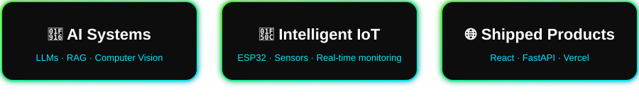

  
  
  

**ECE student · Meenakshi Sundararajan Engineering College · 2024 – 2028**
 
 *Open to internships in AI/ML, AI + IoT, and full-stack roles*

## ⚡ The Short Version

I like projects where **software meets the physical world**: an ESP32 reading a sensor, a vision model making sense of an image, a FastAPI service tying it together, and a React interface a real person can use. I take ideas from **concept → prototype → deployed product**.

  

## 🚀 Featured Work

### 🛰️ SatQuery AI &nbsp;
> **Agentic vision-language assistant for satellite imagery** · Smart India Hackathon 2026 / ISRO (SAC)

Remote-sensing AI is mostly single-task and needs GIS expertise. SatQuery AI lets anyone ask questions in plain language, and an orchestration layer routes each query to the right specialist tool: visual question answering, captioning, text-guided grounding, multitemporal change detection, and optical–SAR fusion.

`Python` `PyTorch` `GeoChat (LLaVA-based)` `LoRA` `FastAPI` `React`  
*Repository coming soon.*

### Deployed web apps

| Project | What it does | Stack | Links |
|---|---|---|---|
| 🍽️ **Sundararajan Canteen System** | Campus food-ordering app that replaces slow, manual canteen ordering | React · TypeScript · Vite | [Repo](https://github.com/Vinzz006/sundararajan-canteen-systemj) · [Live](https://sundararajan-canteen-systemj.vercel.app) |
| 🧠 **MindEase** | Private, AI-assisted mental wellness check-ins powered by Gemini | React · TypeScript · Gemini API | [Repo](https://github.com/Vinzz006/mindease) · [Live](https://mindease-two-opal.vercel.app) |
| ✅ **Task Management App** | Fast, no-bloat daily task tracker | React · TypeScript · Vite | [Repo](https://github.com/Vinzz006/to-do-list) · [Live](https://to-do-list-eta-sage-80.vercel.app) |

## 🛠️ How I Build

  

## 🧰 Tech Stack

**Core: what I use most**

  

**Also working with**

  

| Area | What I work with |
|---|---|
| **AI / ML** | Computer vision, deep learning, LLM apps, RAG, embeddings and vector search, LangChain, Ollama |
| **Embedded / IoT** | ESP32, ESP32-CAM, Embedded C/C++, sensors and actuators, Firebase IoT, real-time monitoring |
| **Backend / Frontend** | FastAPI, Flask, REST APIs, JWT auth, React, TypeScript, Tailwind CSS |
| **Exploring next** | MLOps · Cloud deployment (AWS / GCP) · System design · Kubernetes |

## 🎯 Problem Spaces I Care About

`🏥 Healthcare AI` &nbsp; `🌱 Smart Agriculture` &nbsp; `⛏️ Industrial Safety` &nbsp; `⚡ Energy Monitoring` &nbsp; `🛰️ Remote Sensing`

## 📊 GitHub Stats

## 🐍 Contribution Snake

<picture>
  <source media="(prefers-color-scheme: dark)" srcset="https://raw.githubusercontent.com/Vinzz006/Vinzz006/output/github-snake-dark.svg" />
  <source media="(prefers-color-scheme: light)" srcset="https://raw.githubusercontent.com/Vinzz006/Vinzz006/output/github-snake.svg" />
  
</picture>

## 🤝 Let's Build Something

I'm always up for collaborating on **AI, IoT, computer vision, and full-stack** projects.

### ⚡ Build. Learn. Experiment. Ship.

