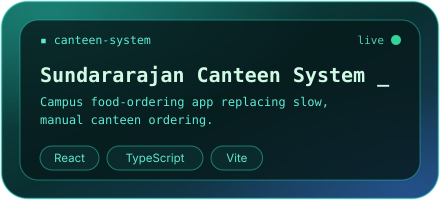

  
   
  

**ECE student · Meenakshi Sundararajan Engineering College · 2024 – 2028**
*Open to internships in AI/ML, AI + IoT, and full-stack roles.*

I like projects where **software meets the physical world**: an ESP32 reading a sensor, a vision model making sense of an image, a FastAPI service tying it together, and a React interface a real person can use. I take ideas from **concept → prototype → deployed product**.

`Problem` → `Research + prototype` → `ML / CV / LLM model` → `FastAPI backend` → `React interface` → `ESP32 / IoT integration` → `Test` → `Deploy`

## The city I built this year

## Population

## GitStats

<table>
  <tr>
    <td width="50%"></td>
    <td width="50%"></td>
  </tr>
</table>

## Landmarks

<table>
  <tr>
    <td width="50%"></td>
    <td width="50%"></td>
  </tr>
  <tr>
    <td width="50%"></td>
    <td width="50%"></td>
  </tr>
</table>

**Repos:** [Canteen System](https://github.com/Vinzz006/sundararajan-canteen-systemj) · [MindEase](https://github.com/Vinzz006/mindease) · [Task Management App](https://github.com/Vinzz006/to-do-list) · *SatQuery AI: coming soon*

## Toolkit

  

  

| Area | What I work with |
|---|---|
| **AI / ML** | Computer vision, deep learning, LLM apps, RAG, embeddings and vector search, LangChain, Ollama |
| **Embedded / IoT** | ESP32, ESP32-CAM, Embedded C/C++, sensors and actuators, Firebase IoT, real-time monitoring |
| **Backend / Frontend** | FastAPI, Flask, REST APIs, JWT auth, React, TypeScript, Tailwind CSS |
| **Exploring next** | MLOps · Cloud deployment (AWS / GCP) · System design · Kubernetes |

**Problem spaces I care about:** `🏥 Healthcare AI` `🌱 Smart Agriculture` `⛏️ Industrial Safety` `⚡ Energy Monitoring` `🛰️ Remote Sensing`

## Visit

  
  
  

